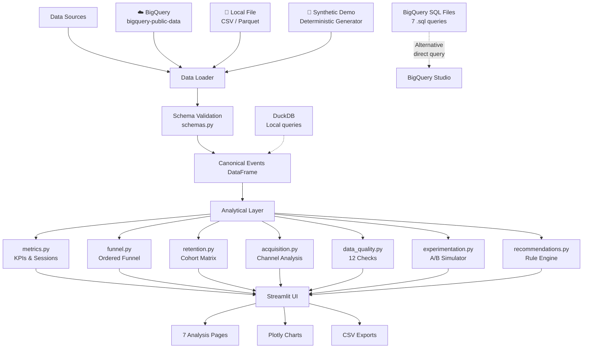

# 🔍 GrowthLens — Product Analytics Intelligence Platform

> **From User Behavior to Business Decisions**

[](https://www.python.org/)
[](https://streamlit.io/)
[](LICENSE)

GrowthLens is a complete, professional product analytics intelligence platform that transforms raw GA4 ecommerce event data into defensible business findings. It is designed as a portfolio-quality demonstration of data engineering, analytical SQL, statistical methods, and interactive data visualization.

> ⚠️ **Dataset notice:** The primary data source is Google's historical GA4 obfuscated sample dataset (November 2020–January 2021). It does NOT represent current Google business performance, any named company, or live traffic. All findings are from historical, obfuscated, pseudonymous data.

---

## Business Problem

An ecommerce company's leadership doesn't understand:

- Where users abandon the purchase journey
- Which acquisition channels and devices convert better
- How user retention varies between cohorts
- Whether observed metric differences are statistically meaningful
- Whether data-quality problems make a reported metric unreliable

GrowthLens addresses each question with documented analytics, reproducible SQL, statistical rigor, and interactive visualization.

---

## Key Questions Addressed

| Question | Page |
|---|---|
| What are today's top KPIs and where should I look first? | Executive Overview |
| Where do sessions drop off in the purchase funnel? | Conversion Funnel |
| Which user cohorts return and how often? | Retention Cohorts |
| Which channels and devices drive quality traffic? | Acquisition Insights |
| Is this A/B test result statistically significant? | Experiment Lab |
| Can I trust the data for this analysis? | Data Quality |
| What should the team investigate or change? | Recommendations |

---

## Dataset

**Source:** [GA4 Obfuscated Sample Ecommerce Dataset](https://developers.google.com/analytics/bigquery/web-ecommerce-demo-dataset)

**BigQuery table:** `bigquery-public-data.ga4_obfuscated_sample_ecommerce.events_*`

**Period:** November 1, 2020 – January 31, 2021

**Limitations:**
- Historical, obfuscated data — not live or current
- `user_pseudo_id` is a cookie identifier, not an authenticated user
- `traffic_source` fields are first-user attribution, not session-level
- Revenue values may be scaled or altered for privacy
- Cross-device user stitching is not available

---

## Application Pages

| # | Page | What It Does |
|---|---|---|
| 1 | **Executive Overview** | KPI cards, daily trends, device/channel breakdowns, CSV export |
| 2 | **Conversion Funnel** | Session-based ordered funnel, drop-off analysis, segment comparisons, findings engine |
| 3 | **Retention Cohorts** | Weekly cohort retention heatmap, aggregate curves, cohort size comparison |
| 4 | **Acquisition Insights** | Source/medium matrix, device analysis, acquisition performance scoring |
| 5 | **Experiment Lab** | A/B test simulator with z-test, CI, power analysis — **clearly labeled as simulated** |
| 6 | **Data Quality** | 12 automated checks covering nulls, timestamps, revenue, duplicates, sequences |
| 7 | **Recommendations** | Rule-based, data-driven findings with evidence and testing plans |

---

## Architecture



---

## Data Flow

```
Raw GA4 Events
    │
    ▼
[Extract] bigquery_client.py / local file / synthetic.py
    │   (date-bounded, column-selected, cost-guarded)
    ▼
[Validate] schemas.py
    │   (required columns, type coercions, null checks)
    ▼
Canonical Events DataFrame (Parquet-cacheable)
    │
    ▼
[Transform] metrics.py → build_sessions()
    │   (session_key construction, funnel flags, revenue aggregation)
    ▼
Session-Level DataFrame
    │
    ├── funnel.py → compute_ordered_funnel()
    ├── retention.py → build_retention_matrix()
    ├── acquisition.py → acquisition_performance()
    ├── data_quality.py → run_all_quality_checks()
    └── recommendations.py → generate_recommendations()
         │
         ▼
    Streamlit Pages (cached with @st.cache_data)
```

---

## Technology Stack

| Component | Technology | Purpose |
|---|---|---|
| UI | Streamlit 1.40+ | Interactive multi-page dashboard |
| Data Processing | Pandas 2.2+, NumPy 1.26+ | Event and session manipulation |
| Local Analytics | DuckDB 1.1+ | SQL over local Parquet files |
| Visualization | Plotly 5.24+ | Interactive charts |
| Statistics | SciPy 1.13+ | Z-test, confidence intervals, power analysis |
| BigQuery | google-cloud-bigquery 3.25+ | GA4 data extraction |
| File I/O | PyArrow 17+ | Parquet reading/writing |
| Testing | Pytest 8.3+ | Automated test suite |
| Config | python-dotenv | Environment variable management |

---

## Installation (macOS)

### Prerequisites

- macOS 12+ (Intel or Apple Silicon)
- Python 3.11+ (Homebrew: `brew install python@3.11`)
- Git

### Quick Start

```bash
# Clone the repository
git clone https://github.com/aashishnoxx7/growthlens.git
cd growthlens

# Create a virtual environment
python3 -m venv .venv
source .venv/bin/activate

# Install dependencies
pip install -r requirements.txt

# Run the synthetic demo (no credentials needed)
streamlit run app.py
```

The app will open at [http://localhost:8501](http://localhost:8501) with synthetic demo data pre-loaded.

---

## Running the Synthetic Demo

No credentials or external access required.

```bash
source .venv/bin/activate
streamlit run app.py
```

The sidebar will show **🧪 Demo (Synthetic)** as the active source. All pages display:

```
⚠️ DEMO MODE — SYNTHETIC DATA, NOT ACTUAL BUSINESS PERFORMANCE
```

To pre-generate and save demo data locally:

```bash
python scripts/generate_demo_data.py
# Creates data/demo_events.csv and data/demo_events.parquet
```

---

## Connecting to BigQuery

### Setup

1. **Install Google Cloud CLI** (if not already installed):
   ```bash
   brew install --cask google-cloud-sdk
   ```

2. **Authenticate:**
   ```bash
   gcloud auth application-default login
   ```

3. **Set your GCP project** (billing must be enabled):
   ```bash
   export GOOGLE_CLOUD_PROJECT=your-project-id
   # Or add to .env:
   echo "GOOGLE_CLOUD_PROJECT=your-project-id" >> .env
   ```

4. **Configure cost limits** (optional — default is 10 GB):
   ```bash
   echo "BQ_MAX_BYTES_BILLED=5000000000" >> .env  # 5 GB limit
   ```

5. Restart the app and select **☁️ BigQuery (GA4)** in the sidebar.

### Cost note

The GA4 sample dataset is in `bigquery-public-data`. Query costs are billed to YOUR project (typical full extract: ~1–5 GB, well within the free tier for new GCP projects). The app performs a dry-run before executing to estimate cost and refuses to run queries exceeding `BQ_MAX_BYTES_BILLED`.

### Direct SQL execution

All queries in `sql/bigquery/` can be run directly in [BigQuery Studio](https://console.cloud.google.com/bigquery). Copy and paste the SQL, ensure your project is selected for billing.

---

## Uploading Local Data

```bash
# Option 1: Generate demo data
python scripts/generate_demo_data.py

# Option 2: Export from BigQuery
python scripts/extract_bigquery.py --output data/ga4_events.parquet

# Option 3: Place any compatible CSV or Parquet in data/
# Required columns: event_date, event_timestamp, event_name, user_pseudo_id
```

Then select **📁 Local File** in the sidebar and choose your file.

---

## Running the Application

```bash
source .venv/bin/activate
streamlit run app.py

# Alternative port
streamlit run app.py --server.port 8502
```

Navigate to [http://localhost:8501](http://localhost:8501).

## Deploying to Vercel

This project includes a `Dockerfile.vercel` so Vercel can run the Streamlit HTTP server in a container. Import the GitHub repository in Vercel; Vercel will build and deploy it on each push. The app starts in synthetic demo mode and does not need credentials.

---

## Running Tests

```bash
source .venv/bin/activate

# Run all tests
pytest

# With coverage
pytest --cov=src/growthlens --cov-report=term-missing

# Run a specific test module
pytest tests/test_funnel.py -v

# Run tests matching a pattern
pytest -k "test_funnel" -v
```

All tests run without Google credentials or external services.

---

## SQL Queries

### BigQuery queries (`sql/bigquery/`)

| File | Purpose |
|---|---|
| `01_source_profile.sql` | Dataset profiling and event distribution |
| `02_daily_kpis.sql` | Daily aggregated KPIs |
| `03_session_funnel.sql` | Session-based ordered conversion funnel |
| `04_weekly_cohort_retention.sql` | Weekly cohort retention matrix |
| `05_acquisition_breakdown.sql` | Acquisition channel analysis |
| `06_device_breakdown.sql` | Device-level performance |
| `07_item_performance.sql` | Product/item performance |

**To run in BigQuery Studio:**
1. Open [BigQuery Studio](https://console.cloud.google.com/bigquery)
2. Copy query from `sql/bigquery/*.sql`
3. Select your billing project
4. Click **Run**

### DuckDB queries (`sql/duckdb/`)

```python
import duckdb
conn = duckdb.connect()
conn.execute("CREATE TABLE events AS SELECT * FROM read_parquet('data/ga4_events.parquet')")
result = conn.execute(open('sql/duckdb/analytical_queries.sql').read()).df()
```

---

## Metrics and Methodology

See:
- [`docs/metrics_dictionary.md`](docs/metrics_dictionary.md) — Complete KPI definitions
- [`docs/methodology.md`](docs/methodology.md) — Analytical methods and assumptions

Key design decisions:
- **Session key** = `user_pseudo_id + '_' + ga_session_id` (GA4 session_id alone is not globally unique)
- **Funnel ordering** enforced temporally (first occurrence of each stage)
- **Cohort** = calendar week of first observed event ("first-observed-activity cohort")
- **Revenue** = `purchase_revenue_in_usd` summed at event level, never at item level

---

## Data Quality Safeguards

12 automated checks run on every loaded dataset:
- Missing user and session identifiers
- Invalid timestamps
- Duplicate event candidates  
- NULL revenue on purchase events
- Missing transaction IDs
- Revenue outliers (> 3.5 standard deviations)
- Out-of-order temporal sequences
- Unexpected event names

Results are displayed in the **Data Quality** page and exportable to CSV.

---

## Statistical Assumptions

The Experiment Lab uses:
- Two-sided two-proportion z-test (pooled SE under H₀)
- Wilson score confidence intervals
- Standard power formula for two proportions

**All experiment results are simulated** — they are not derived from historical observations.

See [`docs/methodology.md`](docs/methodology.md) for full statistical documentation.

---

## Optional: Streamlit Community Cloud Deployment

1. Push the repository to GitHub (ensure `.env` and `data/` contents are gitignored).
2. Connect [share.streamlit.io](https://share.streamlit.io) to your repository.
3. Set secrets in the Streamlit Cloud UI (not in `.env`):
   ```toml
   GOOGLE_CLOUD_PROJECT = "your-project-id"
   ```
4. The app will run in Demo mode when BigQuery credentials are not configured.

**Note:** Google Cloud credentials for a deployed app require a service account key stored as a Streamlit secret. Follow [Streamlit's guide for GCP authentication](https://docs.streamlit.io/knowledge-base/tutorials/databases/bigquery).

---

## GitHub Publication Checklist

Before publishing:
- [ ] `.env` is in `.gitignore` and not committed
- [ ] `data/*.csv`, `data/*.parquet` are gitignored
- [ ] No service-account JSON files in the repository
- [ ] No hardcoded credentials in any Python file
- [ ] All tests pass (`pytest`)
- [ ] App starts in demo mode without credentials (`streamlit run app.py`)
- [ ] README accurately reflects the demo limitations
- [ ] Synthetic data is clearly labeled throughout the UI
- [ ] No fabricated business findings in documentation

---

## Planned Enhancements

- [ ] GA4 item-level analysis page (product performance, basket analysis)
- [ ] User-level funnel analysis (distinct users, not sessions)
- [ ] Revenue trend and seasonality decomposition
- [ ] Segment Explorer — cross-filter any dimension
- [ ] DuckDB local SQL execution in the UI
- [ ] Streamlit Cloud one-click deploy badge
- [ ] Docker container for reproducible environment
- [ ] Support for BigQuery Storage Read API for faster extraction

---

## Project Structure

```
growthlens/
├── app.py                        # Main Streamlit entry point
├── pages/                        # Multi-page app pages
│   ├── 01_Executive_Overview.py
│   ├── 02_Conversion_Funnel.py
│   ├── 03_Retention_Cohorts.py
│   ├── 04_Acquisition_Insights.py
│   ├── 05_Experiment_Lab.py
│   ├── 06_Data_Quality.py
│   └── 07_Recommendations.py
├── src/growthlens/               # Core analytical package
│   ├── config.py                 # Configuration, env vars
│   ├── schemas.py                # Schema validation
│   ├── synthetic.py              # Demo data generator
│   ├── data_loader.py            # Unified data loading
│   ├── bigquery_client.py        # BQ authentication & queries
│   ├── metrics.py                # KPI calculations
│   ├── funnel.py                 # Ordered funnel analysis
│   ├── retention.py              # Cohort retention
│   ├── acquisition.py            # Channel analysis
│   ├── experimentation.py        # A/B test statistics
│   ├── data_quality.py           # Quality checks
│   ├── recommendations.py        # Rule-based recommendations
│   └── visualization.py          # Plotly chart builders
├── sql/
│   ├── bigquery/                 # 7 BigQuery Standard SQL files
│   └── duckdb/                   # Local analytical SQL
├── tests/                        # Pytest test suite
├── scripts/                      # CLI utilities
├── data/                         # Local data files (gitignored)
├── docs/                         # Documentation
│   ├── metrics_dictionary.md
│   ├── methodology.md
│   ├── resume_bullets.md
│   └── interview_prep.md
├── .env.example                  # Config template (no secrets)
├── requirements.txt
├── pytest.ini
└── README.md
```

---

## License

MIT — see [LICENSE](LICENSE).

---

*GrowthLens is a portfolio project. The GA4 dataset is historical, obfuscated, and provided by Google for educational use only.*
